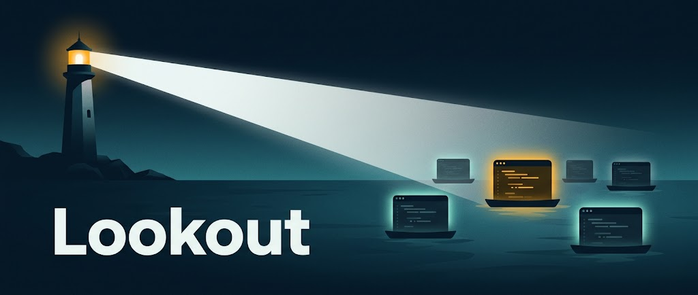
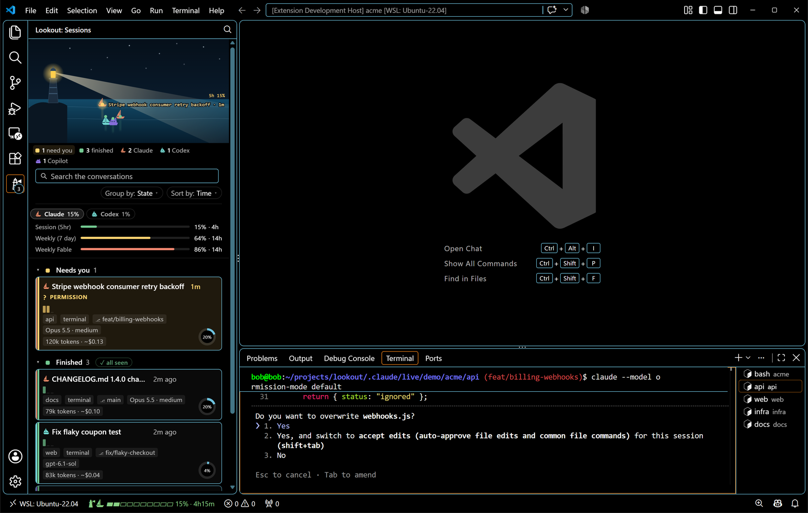

<p align="center">
  
</p>

<p align="center">
  <a href="https://marketplace.visualstudio.com/items?itemName=nimrod-teich.lookout"></a>
  <a href="https://open-vsx.org/extension/nimrod-teich/lookout"></a>
  
  
  
  
  <a href="LICENSE"></a>
</p>

<p align="center"><b>Every AI coding agent session at a glance: what is working, what needs you, and where.</b><br>Works with Claude Code, Codex and Copilot CLI.</p>

<p align="center">
  <a href="#what-it-does">What it does</a> &nbsp;|&nbsp;
  <a href="#supported-agents">Supported agents</a> &nbsp;|&nbsp;
  <a href="#install">Install</a> &nbsp;|&nbsp;
  <a href="#commands">Commands</a> &nbsp;|&nbsp;
  <a href="#documentation">Documentation</a>
</p>

<p align="center">
  
</p>

Running several AI coding agents at once means clicking through tabs and terminals to find out which one finished and which one is stuck on a question. Lookout keeps that answer on one board in the side bar, takes you to the right tab or terminal with one keystroke, and finds any conversation, running or not, by a word you remember from it. Claude Code in its VS Code panel or a terminal, Codex in its extension's panel, VS Code's Chat or a terminal, Copilot in VS Code's Chat or a terminal: one board, one jump key, one search, each agent with its own colour and boat once more than one is on the board. It reads only what the agents already write on disk.

## What it does

- **Board.** The Lookout view in the activity bar. At the top, the harbour: a night scene where every session is a boat, placed by its state and by how long it has been there. Below, one card per session, grouped into Needs you, Finished, Working and Idle, or by project, branch, model, agent or window; a click on a group's heading folds it, and a drag puts a card where you want it in its group.
- **Cards.** Each card shows the session's title, its time in state, what it asks you when it waits (the permission with its command or file, the question with its answers, the plan to approve), its tool calls per minute, how full its context window is, its tokens and their price, its project, worktree and git branch, where it runs, and its model with the reasoning effort of its last reply. A click jumps to the session; a click on its title renames it.
- **Jump.** `Ctrl+Alt+J` lists the sessions, the ones that need you first, and brings the chosen one's tab or terminal to the front, in this VS Code window or in another on the same machine. `Ctrl+Alt+Shift+J` goes straight to the session that has waited longest.
- **Notify.** A notification with a Jump button when a session starts to wait for you, saying why, and optionally when one finishes. While VS Code is not in front, the same notification shows on your desktop, with a sound if you want one.
- **Search.** A box above the cards looks through every conversation, live and earlier, for the words you remember, with `since:`, `before:`, `project:`, `branch:` and `file:` to narrow it. A search page gives the matches room to read, and a conversation tab shows any session whole, scrolled to the match.
- **Earlier, favourites and archive.** Under the live sessions, the ones that are not running, of this window's folders or of every project on the machine, 20 to a page; a click resumes one. A star keeps a session at the top of the board; an archive button puts one away, and a running session you are done with can be parked, out of the way until it works again.
- **Usage.** Every limit of the account, named as the agent's own panel names it, on the board and in the status bar: the 5-hour window as a coloured bar with the time to its reset. Lookout says so once per window when the 5-hour window reaches 70% and 90%, and the week 90%.
- **No setup.** Lookout reads the state the agents already record on disk. It installs no hooks, reads no credentials, and sends nothing off the machine.

[What Lookout shows](docs/features.md) describes each of these in full, and the session states.

## Supported agents

| Agent | Live sessions | Jump to terminal | Jump to tab | Rename | Resume | Search | Usage |
| --- | --- | --- | --- | --- | --- | --- | --- |
| [Claude Code](https://claude.com/claude-code) | ✓ in the VS Code panel and in terminals | ✓ | ✓ | ✓ | ✓ | ✓ | ✓ |
| [Codex](https://github.com/openai/codex) | ✓ the Codex extension's panel, VS Code's Chat (its **Codex** sessions), the `codex` program in terminals, and `codex exec` runs | ✓ | ✓ | — | ✓ in the panel, VS Code's Chat or a terminal | ✓ | ✓ |
| Copilot ([CLI](https://github.com/github/copilot-cli), and VS Code's Chat) | ✓ VS Code's Chat (its **Copilot**, **Copilot CLI** and **Local** sessions), and the `copilot` program in terminals | ✓ | ✓ | — | ✓ in VS Code's Chat or a terminal | ✓ | — |

Each agent has its own colour and boat once more than one is on the board. Where an agent lacks an action, Lookout leaves it out rather than offering one that fails. [Supported agents](docs/agents.md) says what each column means, where each agent runs (its panel, VS Code's Chat, a terminal, a script, the desktop app, the cloud) and what a click does there, and what applies to some agents only.

## Install

Install from the Visual Studio Marketplace, or from Open VSX, the registry that Cursor, Kiro, Antigravity, VSCodium and other VS Code forks read:

| Where | How |
| --- | --- |
| VS Code | The [Marketplace listing](https://marketplace.visualstudio.com/items?itemName=nimrod-teich.lookout), or `ext install nimrod-teich.lookout` in the Quick Open box (`Ctrl+P`) |
| Cursor | `cursor --install-extension nimrod-teich.lookout`, or search the Extensions view for Lookout |
| Kiro, Antigravity, VSCodium and other forks | The [Open VSX listing](https://open-vsx.org/extension/nimrod-teich/lookout), or search the Extensions view for Lookout |
| Any of them, by hand | Download `lookout-<version>.vsix` from the [Releases page](https://github.com/nimrod-teich/lookout/releases), then `code --install-extension lookout-<version>.vsix` |

Or build it from source:

```bash
git clone https://github.com/nimrod-teich/lookout.git
cd lookout
npm install
npm run package
code --install-extension lookout-*.vsix
```

Updating an installed copy restarts the extension host, which ends the agent sessions that window hosts. Update when they are idle.

### Requirements

- VS Code 1.94 or newer.
- The extension runs where the agent runs: Linux, macOS or Windows, including WSL and remote hosts (SSH, containers), since it lives on the remote side there.
- A recent version of a [supported agent](#supported-agents).

On SSH and container remotes Lookout runs on the remote machine, where none of your desktop is, so desktop notifications are off there; the notification inside the VS Code window still comes. Under WSL they reach the Windows desktop.

## Commands

| Command | Key | What it does |
| --- | --- | --- |
| `Lookout: Jump to Session` | `Ctrl+Alt+J` | Lists the sessions and brings the chosen one's tab or terminal to the front. |
| `Lookout: Jump to Next Session That Needs You` | `Ctrl+Alt+Shift+J` | Jumps to the session that has waited longest for you, then to the finished ones. Each press moves to the next. |
| `Lookout: Mark All Sessions as Seen` | | Clears every "finished" mark. |
| `Lookout: Show Sessions` | | Opens the board. Clicking the status bar item runs it too. |
| `Lookout: Refresh Usage` | | Has Claude Code fetch the account's usage again. |
| `Lookout: Search All Sessions` | | Opens the search page: every conversation's matches in an editor tab. |

Every setting, with its default, is in [Settings](docs/settings.md).

## Documentation

| Page | What it covers |
| --- | --- |
| [What Lookout shows](docs/features.md) | Every part of the board, the search, the usage, the status bar, jump and notifications, and the session states. |
| [Supported agents](docs/agents.md) | What the table above means, where each agent runs and what a click does there, and the limitations that apply to some agents only. |
| [Settings](docs/settings.md) | Every `lookout.*` setting with its default. |
| [How it works](docs/how-it-works.md) | Which processes, files and commands Lookout reads, for every agent and for each one. |
| [Development](docs/development.md) | Building and testing, the board's preview page, adding an agent, releasing. |
| [Changelog](CHANGELOG.md) | What each version brought. |

## Development

Node 22 or newer. `npm run check`, `npm run lint` and `npm test` are what CI runs; `npm run build` bundles to `dist/`, and F5 in VS Code runs the extension in an Extension Development Host. [Development](docs/development.md) has the rest: the layout of the source, the board's preview page and its fixtures, how to add an agent, and how to release.

## License

[MIT](LICENSE)

---

<p align="center"><sub>Lookout is an independent project, free and MIT. It is not affiliated with or endorsed by Anthropic or any other agent vendor. If it saves you a tab hunt a day, <a href="https://github.com/sponsors/nimrod-teich">sponsor it ♥</a>.</sub></p>
