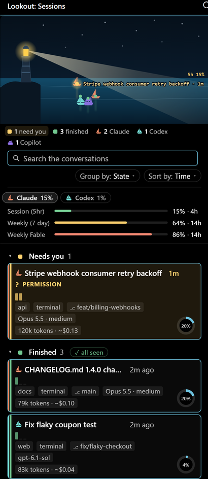
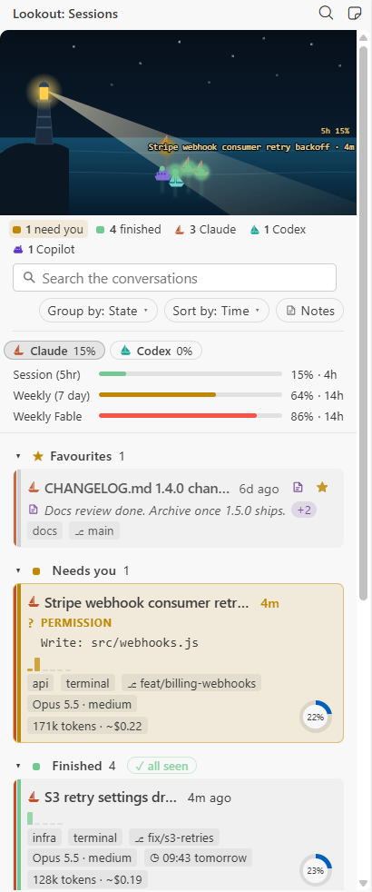
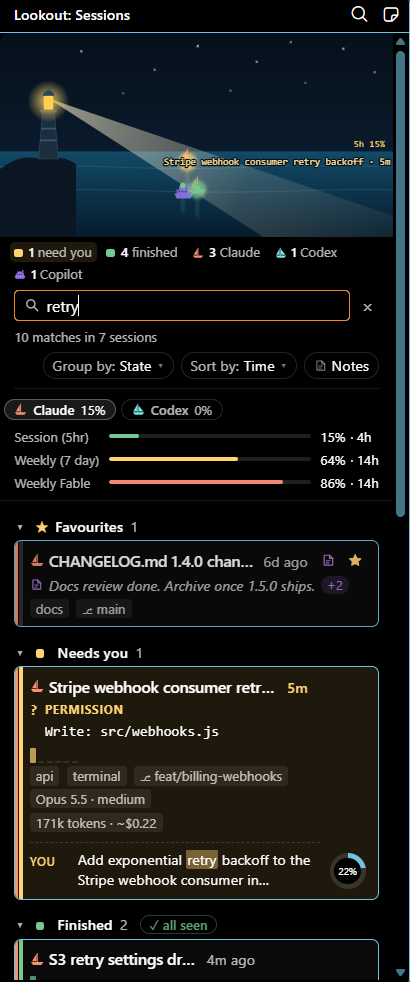
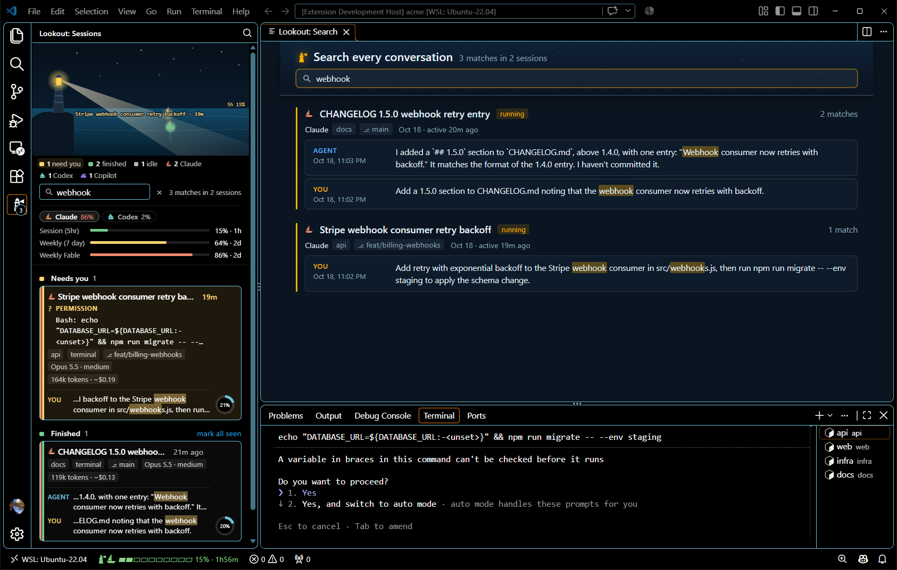
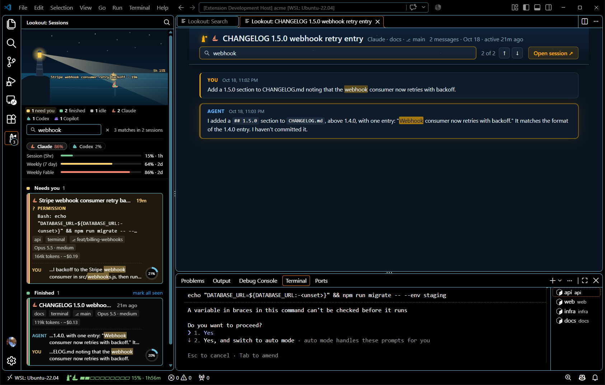
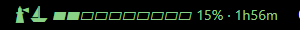

# What Lookout shows

Every part of Lookout, in full: the board and its cards, favourites, the Earlier and Archived groups, search, the search page, the conversation tab, usage, the status bar, jump, notifications, and the session states. The [README](../README.md) has the short version.

<table>
  <tr>
    <td><b>Board</b></td>
    <td>The Lookout view in the activity bar. At the top, the harbour: a night scene where every session is a boat on the water. Its lane says its state, its distance from the lighthouse how long it has been there; the beam lights the boats it passes and swings to a boat before a jump, and the tide rises with your 5-hour usage. Hover a boat for the session's details; its card lights up below.</td>
  </tr>
  <tr>
    <td><b>Cards</b></td>
    <td>One card per session, grouped into Needs you, Finished, Working and Idle: the title, time in state, what it asks you when it waits, its tool calls per minute over the last 15 minutes (the bars grow from the left while it is younger than that, and a pin marks the minute the conversation was compacted), a ring for how full its context window is (amber from 75%, red from 90%), the tokens it has used so far with their price at API list rates, its project and worktree, its git branch (`⎇ main`, read from git itself while it runs, so a session working in a worktree shows that worktree's), where it runs, and its model with the reasoning effort of its last reply (`Opus 5.5 · high`). A session that needs you says why and quotes the ask: a permission with the tool and its command or file, a question with its answers, a plan to approve, or another dialog; a reply that ends on a question gets a dashed card. A working session whose transcript has been silent for more than 10 minutes says "quiet" and how long. The card's hover says where its state comes from and how old that is. Click a card to jump to the session: a panel session's tab comes to the front at its newest message, with the cursor in its prompt box, or at the prompt it waits on; a click on its title renames it through the agent; a click on a state in the legend hides that group. A click on a group's heading folds the group to its heading and count, and another click opens it again; Favourites folds the same way, the board remembers what is folded, and a search opens every group while it runs, so its matches show. A tab or terminal with nothing sent yet is left off the board while it is idle; once it works it is listed as "Empty tab" (or "Empty session" in a terminal) until the agent titles it.</td>
  </tr>
  <tr>
    <td><b>Group and order</b></td>
    <td>The board's sections are the states: Needs you, Finished, Working, Idle, with Parked under them. The group chip at the end of the search row (<b>Group by: State</b>, or <code>Lookout: Group Sessions</code> from the Command Palette) makes them instead by <b>Project</b> (worktrees of one repository together), <b>Branch</b>, <b>Model</b>, <b>Agent</b> or <b>Window</b>: one section per value, A to Z, with the sessions that have no value last, each heading saying what states it holds with a dot and a count per state. The sessions that need you stay pinned at the top under their own heading whatever the grouping, so a folded section never hides one; Favourites, Parked and Earlier keep their places. Inside each section, the session that has been in its state longest comes first. The sort chip at the end of the search row (<b>Sort by: Time</b>) always says the order and opens a menu to change it, as does <code>Lookout: Sort Sessions</code> from the Command Palette: by the latest change, by name, by project, by tokens used or by price (most first; a session whose model has no price comes last), or in your own order. Pick <b>Your order</b> from the chip (<b>Sort by: Yours</b>) and drag a card up or down its group (a grip shows beside its rail when you point at it) to put it where you want it; it starts from the order the board showed, and new sessions come first. Under any other order the cards stay put, so nothing changes your order behind your back. A card stays in its group, since its group is its state. The favourites keep their own order, and a drag among them rearranges the stars. The choice and your order are kept for the machine, so every window shows them.</td>
  </tr>
  <tr>
    <td><b>Card menu</b></td>
    <td>Right-click a card for its acts in words, VS Code's own menu: <b>Jump to Session</b>, <b>Open Conversation</b>, <b>Rename…</b>, <b>Mark as Seen</b>, <b>Star</b> or <b>Remove Star</b>, <b>Park</b> or <b>Bring Back from Parked</b>, each shown only when it applies. The buttons on the card do the same in one click.</td>
  </tr>
  <tr>
    <td><b>Parked</b></td>
    <td>A running session whose turn is over, idle or finished, shows a park button, a parking sign <b>P</b>, next to its star when you point at its card. A click moves it to <b>Parked</b>, a group under Idle that starts folded; the same button on a parked card, a return arrow, brings it back. A session idle or finished for 24 hours goes there on its own (<code>lookout.parkAfterHours</code>, <code>0</code> for never). A parked session has no boat in the harbour and keeps no finished mark, and it leaves Parked as soon as it works or waits for you again. Parked sessions are kept for the machine, so every window shows them.</td>
  </tr>
  <tr>
    <td><b>Favourites</b></td>
    <td>A small star on every card, live and earlier, shows when you point at the card; a click stars the session, and its star stays lit. Starred sessions are gathered at the top of the board, newest star first or in the order you drag them into, running or not and whatever project they belong to: a click jumps to a running one, resumes an earlier one of this window's folders, or opens another project's conversation. Stars are kept for the machine, so every window shows them.</td>
  </tr>
  <tr>
    <td><b>Notes</b></td>
    <td>A note on any session, running or not: one line to remember it by, such as why it is starred or what came of it. A note button shows on every card's title row when you point at the card, lit once the session has a note; a click opens VS Code's input box, as do, on a running card, <b>Add Note…</b>, <b>Change Note…</b> and <b>Remove Note</b> in its menu; an empty box takes the note away. On a card that is not running, under Favourites, Earlier or Archived, the note reads under the title in a colour of its own, and a click on it changes it; a running card keeps its note in its hover and in the lit button, so the board stays quiet. Lookout keeps the notes itself, for the machine: one small file per noted session under its own storage, with the session's title, project and branch as last seen, so every window shows them and a note outlives the agent's transcript. The search reads a note as one more line of its session's conversation: a word in a note finds the session, with the note first among its matches, marked <b>note</b>, and a click on that match changes the note; <code>has:note</code> lists every session with a note, wherever it ran, each with its note, and takes the other operators, the times going by when the note was written; a note names no file, so with <code>file:</code> it counts only for a session whose conversation touched one. <code>Lookout: Show Session Notes</code>, the note icon on the board's title bar, opens the search page on them.</td>
  </tr>
  <tr>
    <td><b>Earlier</b></td>
    <td>Under the live sessions, a collapsed group holds the sessions that are not running and that the agent has not archived, newest first: those of this window's folders, or those of every project on the machine, as the toggle on its heading says (<b>This window's folders</b> or <b>All projects</b>, kept per workspace). Each shows its project and the git branch it last worked on. The group lists the newest 500 and says so when there are more; older ones are not listed or searched. It shows 20 at a time: <b>‹ Newer</b> and <b>Older ›</b> under them turn the page, and a search or a change of scope starts again from the newest. Click the heading to open it. Click a session of this window's folders to resume it in the agent's panel; a session of another project opens its conversation instead, because the agent resumes a session only in a window open on its folder.</td>
  </tr>
  <tr>
    <td><b>Archive</b></td>
    <td>An earlier card shows an archive button next to its star when you point at it. A click moves the session to an <b>Archived</b> group under Earlier, collapsed and paged the same way, newest archive first, whatever project it belongs to; the button on an archived card brings it back to Earlier. Archiving takes the session's star away, and a session that runs again leaves the archive. A search covers archived sessions too and opens the group on a match. Lookout keeps this archive itself, for the machine, so every window shows it; it writes nothing to the agents. Sessions archived in Claude Code's own panel, or by Codex, stay out of both groups.</td>
  </tr>
  <tr>
    <td><b>Search</b></td>
    <td>A box above the cards looks through every conversation, live and earlier (in the Earlier group's scope): what you wrote and what the agent replied, not tool traffic. Every word must appear in one message. Operators narrow it: <code>since:</code> and <code>before:</code> keep the messages written in a time (<code>today</code>, <code>yesterday</code>, <code>12h</code>, <code>3d</code>, <code>2w</code>, <code>2026-10-01</code>); <code>project:</code> and <code>branch:</code> keep the sessions whose project, worktree or git branch contains the value; <code>file:</code> keeps the sessions whose tool calls worked on a path containing it. Several <code>project:</code>, <code>branch:</code> or <code>file:</code> values mean any of them; of several times, the narrowest counts; a value with spaces goes in quotes. Days begin at midnight in your time zone, also in a remote window. Operators alone list the sessions they keep. The sessions with matches stay, each with its newest three matches under the card and the words marked; the rest hide until the box is cleared. The conversations are read in a thread of Lookout's own from the moment the window opens, so the first search finds them read; a new window reads only where another one found their words, and what was added since. While some are still being read, the box says how many are left and their matches come in as they are.</td>
  </tr>
  <tr>
    <td><b>Search&nbsp;page</b></td>
    <td>The same search with the room to read it, in an editor tab: <code>Lookout: Search All Sessions</code>, the search icon on the board's title bar, or a click on the board's "195 matches in 61 sessions". Every session with matches is listed, the newest match first, with its project, git branch, whether it is running, and up to 20 of its matches, each with who wrote it, when, and the sentence around it. The page takes the same operators as the board. A click on a match opens the conversation tab at that message; a click on a session, or on "+N more", at its newest match.</td>
  </tr>
  <tr>
    <td><b>Conversation&nbsp;tab</b></td>
    <td>A click on a match, or on "+N more", opens that session's whole conversation in an editor tab, scrolled to the match, under its title, project and git branch, in the harbour's night colours with the messages' Markdown rendered: headings, lists, quotes, links, inline code and code blocks. The tab has a search of its own: it marks the words, dims the messages without them, and steps through the matches with Enter and the arrows. It follows the conversation as it grows, and an Open session button brings the agent's own tab or terminal to the front.</td>
  </tr>
  <tr>
    <td><b>Usage</b></td>
    <td>Every limit of the account on the board and in the status bar's hover, as Claude Code's own panel shows them: <b>Session (5hr)</b>, <b>Weekly (7 day)</b> and the per-model weekly limits such as <b>Weekly Fable</b>, each on one line with a thin bar, its share used and when it resets (<code>61% · 2d</code>). The session limit also shows as a coloured bar in the status bar item, with the time to its reset: <code>32% · 1h12m</code>. The bars turn amber from half and red from 80%; a card's context ring turns amber from 75% and red from 90%. Lookout says once per window when the 5-hour window reaches 70% and 90% and the week 90%, in the VS Code window in front when there is one. Numbers more than 30 minutes old, or from before a reset, turn grey. Claude Code fetches the numbers again when they are older than 10 minutes or a window has reset, with its own credentials: at most once every 3 minutes on the machine, and less often while fetches fail. <code>Lookout: Refresh Usage</code> fetches at once, unless a fetch started in the last 3 minutes. When Anthropic's usage endpoint answers 429, as it does when another app polls it for the same account, no fetch starts before the wait its <code>Retry-After</code> asks, and with no numbers to show the board says "Too many usage checks; next at 14:05". A sign-in without plan limits (an API key, Bedrock or Vertex, or a long-lived token) says "No plan limits for this sign-in". When more than one agent reports usage, each has its own tab above the lines with its session window, the limit that runs out first and the one the status bar's bar shows (<b>Claude 18%</b>, coloured as the bars are; Codex's <b>5h limit</b>), and its hover names another limit when that one is closer to its end; a click on a tab lists that agent's limits, named as that agent names them, and the board keeps that choice (until then it lists the agent the status bar shows). The status bar's bar shows the window under the most pressure, after that agent's boat (<code>lookout.statusBar.usageAgent</code> pins one agent). Codex's group shows its <b>5h limit</b> and <b>Weekly limit</b> as Codex's own <code>/status</code> names them, from what Codex records with each reply, so its numbers are as fresh as its last reply and turn grey after 30 minutes like Claude's; Lookout cannot fetch them anew. The same alerts go out for Codex's windows, named for Codex.</td>
  </tr>
  <tr>
    <td><b>Status bar</b></td>
    <td>One status bar item, the lighthouse, shows your usage and nothing else: the 5-hour window as a ten-cell bar coloured by consumption, with the time to its reset, its background red when a limit is nearly used up. With no usage reported it is the lighthouse alone. Hover for every agent's limits; click it to open the board.</td>
  </tr>
  <tr>
    <td><b>Jump</b></td>
    <td><code>Ctrl+Alt+J</code> lists the sessions, the ones that need attention first, with how long each has been in its state and what each waiting one asks. Pick one and its tab or terminal comes to the front. A session in another VS Code window on the same machine works too: that window brings its tab or terminal forward and comes to the front itself; when the desktop does not let it, Lookout says which window to switch to. <code>Ctrl+Alt+Shift+J</code> goes straight to the session of this window that has waited longest; press it again to cycle through the others that need you.</td>
  </tr>
  <tr>
    <td><b>Notify</b></td>
    <td>A notification with a Jump button when a session starts to wait for you, saying why and quoting the ask, and optionally when one finishes. Neither fires for the session you are looking at. While VS Code is not the window in front, the same notification also shows on your desktop, with a sound if you want one; it cannot jump, so it names <code>Ctrl+Alt+Shift+J</code>. A session gets at most one desktop notification per event every 30 seconds, and while three or more sessions need you, one notification sums them up.</td>
  </tr>
  <tr>
    <td><b>No&nbsp;setup</b></td>
    <td>Lookout reads the state the agent already records on disk. It installs no hooks, reads no credentials, and sends nothing off the machine. The programs it starts are Claude Code's own binary, to refresh the usage numbers, your desktop's own notifier for desktop notifications, and, on macOS and Windows, the system's process list (`ps` and `lsof`, Windows PowerShell) to find the agents' processes.</td>
  </tr>
</table>

  
  

<table>
  <tr>
    <td width="36%"></td>
    <td></td>
  </tr>
</table>

  

  

## Session states

| State | Meaning |
| --- | --- |
| Needs you | The session is blocked on you, and the card says why: a **permission** (the tool and what it would run or change, e.g. `Bash: npm test`, or the call a subagent waits on), a **question** (with its answers), a **plan** to approve, or another **dialog** (the agent's own word for it). A session of this window whose last reply asks you something, ending on a question mark or asking for a choice or a yes/no, is here too, after the prompts, marked as **asked you a question** with a dashed card: Lookout read it from the reply rather than from the agent, so it is less certain. It stays until the session works again or you dismiss it with the card's ✓. |
| Finished | The session finished a turn while you were not looking at it. The mark clears when you open its tab or terminal, and survives a window reload. For a session in a terminal, "looking" means you were last in that terminal: you brought it forward or sent its session a prompt, and switched to no tab, typed in no editor and prompted no panel session since. VS Code keeps a terminal its active one while you work elsewhere, so that alone does not count. A session in another VS Code window that runs Lookout is Finished here as that window marks it; its ✓, "mark all seen" and a jump to it clear the mark in that window too. |
| Working | The session is running a turn. |
| Working in the background | Its turn is over, but shell commands it started (`run_in_background`) still run: the card says "1 background job · 2h", and how long they were busy, "busy 45m", counting the looks at which their processes used CPU or their output grew. With no CPU and no output for 15 minutes it says "idle 20m: may be stuck"; when Claude Code has deleted a job's output file, as after a restart, it says "orphaned". When the last job ends the session is Finished. Linux and WSL. |
| Idle | The session waits for the next prompt. After a window reload the agent restores its tabs but starts a session only once you open its tab: until then the card says "Tab open · not started", from the session's transcript, and a click opens the tab. Tabs of this window's folders only; another project's tab opens blank. |
| State unknown | The session's file records no state, or cannot be read. Lookout does not guess; the card says which. A session in its first minute counts as idle, from its process's start. |
| Parked | A running session you put out of the way, or one idle or finished for longer than `lookout.parkAfterHours` (24 hours). It comes back when it works again. |
| Earlier | Not running. Its transcript is still there, so it can be searched, read in the conversation tab, and resumed from a window open on its folder. |
